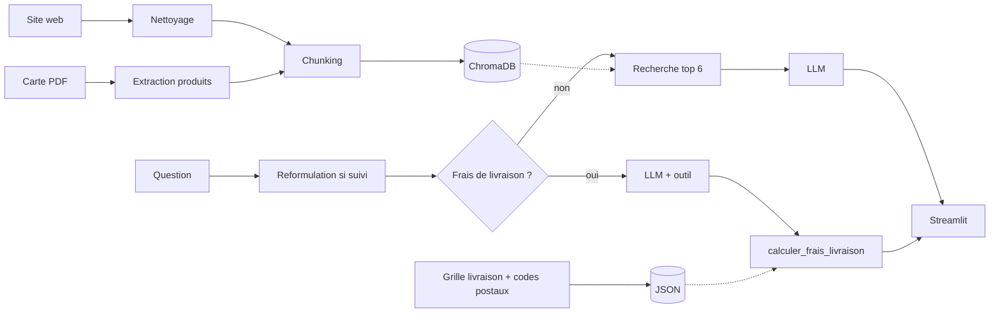

# Chatbot RAG pour un traiteur

Un chatbot qui répond aux questions des clients d'un traiteur parisien (produits, allergènes,
délais de commande, CGV, frais de livraison) à partir du contenu de son site et de sa carte PDF.

Tout tourne en local : le LLM est qwen3 4B via Ollama, sur mon PC portable (RTX 3050 4 Go).


Projet perso, non affilié au traiteur. Je n'ai pas leur accord pour les citer, donc leur nom,
leur site et leurs contacts ne sont pas dans le repo : ils sont lus dans un fichier `.env` local.

## Ce que fait le bot

- Il répond uniquement à partir des extraits retrouvés, et cite ses sources (lien de la page ou
  page de la carte). Le LLM cite des numéros d'extraits, et c'est le code qui retrouve la source,
  comme ça il ne peut pas inventer d'URL.
- Pour les allergènes, c'est le code qui recopie la liste de la carte, pas le LLM. Si le produit
  n'est pas trouvé, le bot renvoie vers le traiteur.
- Les frais de livraison sont calculés par une fonction Python appelée par le LLM (function calling) :
  zone selon le code postal ou la ville, majoration samedi / dimanche / jour férié / dernière minute,
  TVA. Au début je laissais le LLM calculer avec la grille dans le contexte, il se trompait souvent
  de zone et de TVA.
- Il garde le fil de la conversation : "Et le samedi ?" est reformulé en question complète avant
  la recherche.

## Architecture



## Évaluation

J'ai écrit 30 questions de test (délais, allergènes, produits, CGV, livraison et quelques questions
pièges) et comparé deux façons de découper les documents :
- `recursive` : morceaux de taille fixe
- `structure` : un morceau par produit de la carte / par section des pages

| | recursive | structure |
|---|---|---|
| Hit rate@6 | 82 % | 91 % |
| MRR | 0,62 | 0,71 |
| RAGAS faithfulness | 0,76 | 0,74 |
| RAGAS answer_relevancy | 0,72 | 0,72 |
| RAGAS context_precision | 0,60 | 0,60 |
| RAGAS context_recall | 0,50 | 0,52 |
| Règles métier OK | 73 % | 93 % |
| Temps moyen | 10,1 s | 7,6 s |

J'ai gardé `structure` : la recherche trouve plus souvent la bonne source, et surtout les règles
métier passent de 73 % à 93 %. Avec `recursive`, la liste des allergènes d'un produit peut être
coupée en deux morceaux, et le code ne peut plus la recopier.

Pour le juge RAGAS, j'ai d'abord utilisé le même modèle 4B que le bot, en local (4 Go de VRAM,
pas de GPU plus gros). Problème : un modèle qui se note lui-même est biaisé, et ce petit juge
renvoyait souvent des réponses mal formées (`context_precision` calculée sur seulement 4 à 6
questions sur 30). Je suis donc passé à un juge beaucoup plus gros et d'une autre famille,
Nemotron 3 Super 120B, via l'API gratuite de NVIDIA NIM (`python eval/score.py --judge nim`).
Toutes les métriques sont maintenant calculées.

Ce que ça montre : avec un vrai juge, RAGAS ne voit presque pas de différence entre les deux
stratégies, alors que le juge 4B donnait l'avantage à `structure`. La différence est réelle, mais
elle se voit sur la recherche et les règles métier, pas sur la qualité du texte. À noter aussi :
`answer_relevancy` met 0 quand le bot refuse une question piège, alors que c'est ce qu'on veut, et
les 4 questions de frais de livraison ne passent pas par RAGAS (l'outil répond sans extraits).

Détail par question : `eval/results/summary.md` (ancien juge local : `summary_juge_local.md`).

## Lancer le projet

Il faut Python 3.11+ et [Ollama](https://ollama.com).

```bash
python -m venv .venv
.venv\Scripts\activate
pip install -r requirements.txt
ollama pull qwen3:4b-instruct-2507-q4_K_M
```

Copier `.env.example` en `.env` et mettre l'adresse du site et les infos du traiteur.

Les données du traiteur ne sont pas dans le repo non plus. La carte PDF est à télécharger à la main dans
`data/raw/` (le dossier `/upload/` du site est interdit aux robots dans son robots.txt), puis :

```bash
python -m src.scraping.scrape_site
python -m src.ingestion.clean_pages
python -m src.ingestion.load_pdf
python -m src.ingestion.build_index
python -m src.ingestion.delivery_grid
python -m src.ingestion.postal_codes
```

Ensuite :

```bash
streamlit run app/streamlit_app.py
```

Tests et évaluation :

```bash
python -m pytest
python eval/run_answers.py
python eval/score.py --judge nim  # juge NVIDIA NIM (clé dans .env), ~15 min
python eval/score.py --no-ragas   # sans RAGAS, quelques secondes
```

## Stack

Python, requests / BeautifulSoup / trafilatura, PyMuPDF, LangChain, ChromaDB,
sentence-transformers (multilingual-e5), Ollama, Streamlit, RAGAS, pytest.

## Pistes

- Ajouter un re-ranker avant le LLM.
- Tester un modèle plus gros : certaines erreurs viennent du 4B qui a le bon extrait mais répond
  quand même qu'il ne trouve pas.
