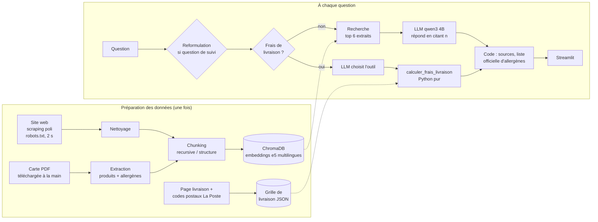

# Chatbot RAG pour un traiteur parisien

Assistant conversationnel qui répond aux questions des clients d'un traiteur (Paris / Île-de-France)
à partir du **contenu public de son site** et de **sa carte PDF** : produits, allergènes, délais de
commande, conditions de vente, frais de livraison.

Projet portfolio, 100 % local : LLM via **Ollama** (qwen3 4B) sur un GPU de portable (RTX 3050, 4 Go).


> Prototype non officiel, non affilié au traiteur. Le nom du traiteur est configurable
> (`BRAND_NAME`) et masqué dans la démo.

## Points forts

- **Réponses sourcées** : chaque phrase cite un extrait `[n]`, traduit par le code en lien vers la
  page du site ou en numéro de page de la carte. Un numéro inventé par le LLM est supprimé.
- **Allergènes jamais inventés** : la liste officielle du produit est recopiée par le code (pas par
  le LLM), avec l'avertissement sur les contaminations croisées ; sinon, renvoi vers l'équipe.
- **Frais de livraison calculés par un outil Python** (*function calling*) : zone par code postal ou
  ville, majorations samedi / dimanche / jours fériés / dernière minute, TVA, arrondis en `Decimal`.
  Le LLM choisit l'outil ; il ne fait aucun calcul.
- **Pas d'hallucination** : si la réponse n'est pas dans les extraits, le bot le dit.
- **Mémoire de conversation** : « Et le samedi ? » est reformulé en question complète.
- **Évaluation** sur 30 questions : recherche, RAGAS et règles métier, pour comparer deux
  stratégies de découpage des documents.

## Architecture



Principe directeur : **ce qui est critique vient du code**, le LLM ne fait que reformuler.

## Résultats de l'évaluation

30 questions rédigées à la main (délais, allergènes, produits, conditions de vente, livraison,
questions pièges), comparaison de deux stratégies de découpage :
- `recursive` : morceaux de taille fixe ;
- `structure` : un morceau par produit de la carte / par section du site.

| Mesure | recursive | structure |
|---|---|---|
| Recherche : hit rate@6 | 82 % | **91 %** |
| Recherche : MRR | 0,62 | **0,71** |
| RAGAS : faithfulness | 0,66 | **0,71** |
| RAGAS : answer_relevancy | 0,63 | 0,64 |
| RAGAS : context_precision | 0,47 | 0,41 |
| RAGAS : context_recall | 0,61 | **0,73** |
| Règles métier respectées | 73 % | **93 %** |
| Temps de réponse moyen | 10,1 s | **7,6 s** |

**`structure` est retenue** : un produit = un morceau, donc sa liste d'allergènes reste entière
et peut être recopiée par le code.

Limites de la mesure, assumées :
- le juge RAGAS est le même petit modèle que le bot (pas de GPU plus gros ni d'API payante) ;
  `context_precision` n'a pu être calculée que sur 4 à 6 questions (réponses du juge mal formées) ;
- `answer_relevancy` vaut 0 quand le bot refuse de répondre à une question piège, alors que c'est
  le comportement voulu ;
- les **règles métier**, vérifiées par du code (montant exact, contact affiché, liste officielle,
  absence de prix inventé...), sont la mesure la plus fiable.

Détail par question : [`eval/results/summary.md`](eval/results/summary.md).

## Installation

Prérequis : Python 3.11+, [Ollama](https://ollama.com).

```bash
python -m venv .venv
.venv\Scripts\activate            # Windows (Linux/macOS : source .venv/bin/activate)
pip install -r requirements.txt
ollama pull qwen3:4b-instruct-2507-q4_K_M
```

### Préparer les données

La carte PDF se télécharge **à la main** (le dossier `/upload/` du site est interdit aux robots)
et se dépose dans `data/raw/`. Les données du traiteur ne sont pas versionnées.

```bash
python src/scraping/scrape_site.py          # scraping du site
python -m src.ingestion.clean_pages          # nettoyage des pages
python -m src.ingestion.load_pdf             # extraction de la carte
python -m src.ingestion.build_index          # chunking + index Chroma (2 stratégies)
python -m src.ingestion.delivery_grid        # grille de livraison
python -m src.ingestion.postal_codes         # communes d'Île-de-France (open data La Poste)
```

### Lancer

```bash
streamlit run app/streamlit_app.py                               # interface web
python -m src.rag.chain "Livrez-vous le dimanche ?"              # ou dans le terminal
```

Démo sans le nom du traiteur : `set BRAND_NAME=Traiteur démo` (PowerShell :
`$env:BRAND_NAME="Traiteur démo"`) avant de lancer.

### Tests et évaluation

```bash
python -m pytest                   # ~120 tests (ceux qui appellent le LLM sont sautés sans Ollama)
python eval/run_answers.py         # réponses aux 30 questions, pour les 2 stratégies
python eval/score.py --no-ragas    # notation rapide (recherche + règles métier)
python eval/score.py               # notation complète avec RAGAS (plusieurs heures en local)
```

## Stack

| Rôle | Outils |
|---|---|
| Scraping | requests, BeautifulSoup, trafilatura, protego (robots.txt) |
| PDF | PyMuPDF (position et police de chaque ligne) |
| RAG | LangChain, ChromaDB, sentence-transformers (`multilingual-e5`) |
| LLM | Ollama, `qwen3:4b-instruct-2507` (quantifié 4 bits), function calling |
| Outil livraison | Python pur, `Decimal`, `holidays`, open data La Poste |
| Interface | Streamlit |
| Évaluation | RAGAS, pandas |
| Tests | pytest, `streamlit.testing` |

## Structure

```
src/scraping/      scraping du site
src/ingestion/     nettoyage, extraction PDF, chunking, index Chroma, grille de livraison
src/rag/           recherche, prompts, chaîne RAG (citations, encadrés, routage)
src/tools/         outil de frais de livraison, lecture des dates
app/               interface Streamlit
eval/              30 questions, génération des réponses, notation
tests/             tests pytest
docs/CONCEPTS.md   explication détaillée de tous les concepts du projet
```

## Pistes d'amélioration

- Un juge RAGAS plus fort (modèle plus gros ou API) pour des scores plus fiables.
- Un *re-ranker* (cross-encoder) pour mieux classer les extraits avant le LLM.
- Un modèle plus gros : certaines erreurs restantes viennent du 4B (extrait trouvé mais mal lu).
- Résoudre les contradictions entre le site et la carte à la source (la carte fait foi ici).
